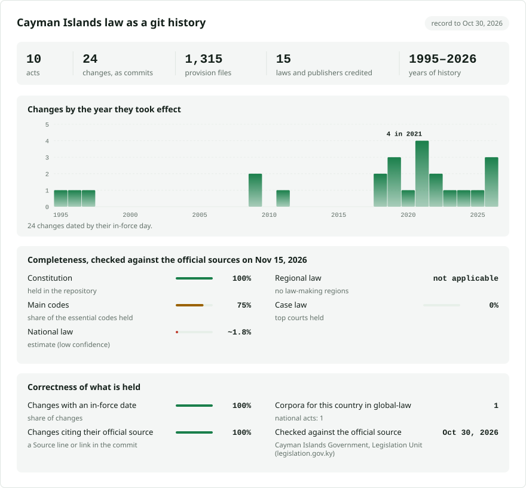

# Cayman Islands: law history in git

<picture>
<source media="(prefers-color-scheme: dark)" srcset="data/effort-dark.svg">

</picture>

The law of the Cayman Islands as a git history: one file per section, one commit per version on the day it took effect, and the Law Revision that carries each change as the commit's author. `git blame` names the version behind every line; `git log` lists every change to a section; picking a date gives the text in force that day.

Part of [lexifina/global-law](https://github.com/lexifina/global-law), one git history for every country's law: this is the Cayman Islands' national law, which global-law reads at `cayman-islands/national/acts/`.

**What is in it now:** the Constitution of the Cayman Islands and the Cayman Islands Constitution Order 2009 that made it, each as made in 2009; and eight Acts in 22 Law Revisions from 1995 to 2026: the Penal Code (5), the Companies Act (6), the Criminal Procedure Code (3), the Evidence Act (3), the Labour Act (2), and the Interpretation Act, the Contracts Act and the Sale of Goods Act (1 each). [`REPRODUCE.md`](REPRODUCE.md) lists every act with its versions; each act's `README.md` lists its provisions and when each last changed.

Each act is a folder named after its short title, with one file per section or schedule: `labour-act/sec-014.md` is section 14 of the Labour Act, vacation leave, and `penal-code/sec-045-a.md` is section 45A of the Penal Code. The Constitution is in `constitution/` (`preamble.md`, then `sec-001.md` to `sec-129.md`), the Order's own articles and Schedule 1 in `constitution-order-2009/`.

The text is in English, as legislation.gov.ky prints it in its PDFs.

## Questions as git commands

| Question | Command |
| --- | --- |
| Every change to section 14 of the Labour Act | `git log -p --word-diff -- labour-act/sec-014.md` |
| Which version wrote each line of section 14? | `git blame labour-act/sec-014.md` |
| Every version of the Labour Act, with the day each took effect | `git log --format="%h %(trailers:key=In-force,valueonly,separator=) %an" -- labour-act ':!*/README.md'` |
| Section 14 as in force on 1 January 2020 | `python tools/on.py 2020-01-01 labour-act 14` |

**Outside git**, we also host this record publicly, for free:

- **[Ask Claude about Cayman Islands law](https://global-law.lexifina.com/v1/try_claude?country=cayman-islands)**: opens Claude with a first question ready.
- **[Ask ChatGPT](https://global-law.lexifina.com/v1/try_chatgpt?country=cayman-islands)**: the same question in ChatGPT.
- **[Search Cayman Islands law on our site](https://lexifina.com/law?country=cayman-islands&q=vacation+leave)**: a search for "vacation leave", with each provision's text and its versions, no account needed.
- **[Developer REST API](https://global-law.lexifina.com/v1/search_law?query=vacation+leave&jurisdiction=cayman-islands)**: the same search as JSON, with no key. See the [documentation here](https://lexifina.com/api/global-law).

Both assistants read the record through the free Global law connector (MCP, `https://global-law.lexifina.com/mcp`); the first time, the chat gives you the link that adds it. Ask in English.

**Host it yourself easily.** All it takes is git and Python, and the tools run on your machine:

```sh
git clone --depth 1 https://github.com/lexifina/global-law && cd global-law
python3 tools/countries.py add cayman-islands/national/acts
python3 tools/law.py show 2026-01-01 cayman-islands/national/acts/labour-act/sec-014.md
```

Opened in Claude Code, Cursor, VS Code or Codex, the clone also starts a local MCP server with the same tools ([MCP.md](https://github.com/lexifina/global-law/blob/main/MCP.md)).

## Dates

Each commit is dated at noon, America/Cayman, on the day the version took effect, and carries it in its `In-force:` trailer:

- for a Law Revision, the commencement date legislation.gov.ky's history table gives it;
- for the Contracts Act (1996 Revision) and the Sale of Goods Act (1997 Revision), for which the site gives none, the day of the Gazette supplement that published them (28 October 1996 and 17 March 1997);
- for the Constitution and the Order, 10 June 2009, the day the Order was made. The Order came into force on a day the Governor appointed by proclamation, and Part I of the Constitution three years after that; the source gives neither day, so this is the date of the oldest version available, not the commencement date.

The first version of each act is the oldest version available, credited to the publisher (`Cayman Islands Government, Legislation Unit (legislation.gov.ky)`). Each later version is credited to the Law Revision that carries it (`The Labour Act (the Labour Law) (2021 Revision)`), not to the amending Acts the revision consolidates.

## How it is checked

- `tools/check_repo.py` reads every version back from git on the day it took effect and on the day before, and compares it, file by file, with the corpus it was built from: 24 versions of 10 acts, 0 mismatches.
- It also checks that every commit's trailers parse, that main has no merge commits and that no commit is dated after the build. The results are in [`REPRODUCE.md`](REPRODUCE.md).
- `tools/build.py` writes the history from one corpus file, and the same corpus always gives the same commit hashes; its sha256 is in `data/corpus.sha256`. No second build has been compared yet.
- History is append-only: later versions are appended on top (`tools/append.py`), never forced.
- [vulnerabilities/](vulnerabilities/): possible drafting mistakes in this law, found by global-law's detectors and checked by hand. Not run yet.

## What it does not show

- **Most Cayman law.** Only these eight Acts and the Constitution: no other Acts, no regulations and no case law.
- **The current Constitution.** The Cayman Islands Constitution (Amendment) Orders 2016 (UKSI 780/2016) and 2020 (UKSI 1283/2020) are not applied, so the text is the Constitution as made in 2009.
- **The amending Acts.** Each version is a whole Law Revision, so a change is credited to the revision that first carries it, not to the Act that made it.
- **Earlier revisions.** Revisions before those held (the Penal Code's of 2017 and before, the Companies Act's before 2020, the Criminal Procedure Code's before 2019, the Evidence Act's before 2018, the Labour Act's before 2011) are not included.
- **Notes and headings.** Footnotes, endnotes, the table of legislation history and most Part headings are left out.

## Sources

| Source | Kind | Past versions | Notes |
| --- | --- | --- | --- |
| [Cayman Islands Legislation](https://legislation.gov.ky) (Cayman Islands Government, Legislation Unit) | Official legislation site | yes, past Law Revisions as PDFs | Each revision's text, and its commencement date from the Act's history table; the Constitution Order's PDF is a copy of the text published on legislation.gov.uk |

## Licence

See [`LICENSE`](LICENSE). The legal text is from legislation.gov.ky, whose PDFs carry no licence statement; the source is credited. Lexifina's own contributions (the history, the commit messages, the tables and the tools) are CC0 1.0.

No AI model wrote, translated or corrected legal text, and none runs when the history is built; the scripts were written by an AI model (see [`REPRODUCE.md`](REPRODUCE.md)).

## Visualisations

- [visualisations/](visualisations/): charts drawn from this repository. Not drawn yet.

## More

From [lexifina/global-law](https://github.com/lexifina/global-law):

- [FEATURES.md](https://github.com/lexifina/global-law/blob/main/FEATURES.md): every feature, and what every corpus must support (`git blame`, `law.py`, the MCP tools)
- [FAQ.md](https://github.com/lexifina/global-law/blob/main/FAQ.md): questions and answers · [CONTRIBUTING.md](https://github.com/lexifina/global-law/blob/main/CONTRIBUTING.md): proposing changes · [MCP.md](https://github.com/lexifina/global-law/blob/main/MCP.md): the MCP server · [REPRODUCE.md](https://github.com/lexifina/global-law/blob/main/REPRODUCE.md): how it was built · [CHANGELOG.md](https://github.com/lexifina/global-law/blob/main/CHANGELOG.md)
- [FRESHNESS.md](https://github.com/lexifina/global-law/blob/main/FRESHNESS.md): how current each corpus is · [Monitoring](https://github.com/lexifina/global-law/tree/main/monitoring): whether updates are running · [WATCHING.md](https://github.com/lexifina/global-law/blob/main/WATCHING.md): how each official source is watched for changes
- [performance/](https://github.com/lexifina/global-law/tree/main/performance): how fast the tools are, measured
- [visualisations/](https://github.com/lexifina/global-law/tree/main/visualisations): charts and bridges across the world's law
- [Vulnerabilities](https://github.com/lexifina/global-law/tree/main/vulnerabilities): mistakes in legislation as published
